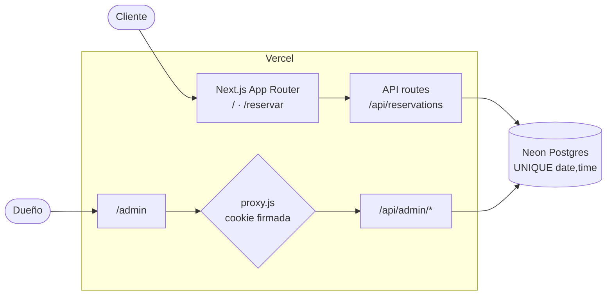

# Mimo Pet Spa — reservas sin WhatsApp

[](https://github.com/Marioyahuar/mimo_demo/actions/workflows/ci-cd.yml)


**Demo:** https://mimo-demo-five.vercel.app · **Admin:** `/admin` (clave única)

Un spa de mascotas coordinaba todas sus citas por WhatsApp, chat por chat: horarios
cruzados, reservas olvidadas y ninguna vista única de la agenda. Mimo Pet Spa permite que el
cliente reserve desde el celular, sin cuenta, y le da al dueño un panel con todas las
reservas, con **cero reservas dobles garantizadas por la base de datos**.

> Proyecto de referencia del curso **Desarrollo AI-First con Claude**. Sirve como ejemplo
> de lo que se espera en el proyecto integrador: un producto funcionando, construido sobre
> un pipeline documental en el que cada documento responde al anterior.

## Qué hace

- **Reserva en 6 pasos**: servicio → mascota → extras → fecha y hora → contacto → confirmación.
  Los horarios ocupados se deshabilitan en vivo.
- **Sin doble booking**: si dos clientes confirman el mismo horario a la vez, solo uno queda
  reservado y el otro recibe un aviso para elegir otro horario, sin perder lo que ya cargó.
- **Reintentos seguros**: un doble clic o una red inestable nunca crean dos reservas
  (idempotencia por intento).
- **Panel `/admin`** protegido por clave, con todas las reservas ordenadas por fecha y hora.
- **Respaldo por WhatsApp**: la confirmación incluye un botón `wa.me` con el mensaje prellenado.

## Arquitectura



| Capa | Tecnología | Decisión |
|---|---|---|
| Frontend + API | Next.js 16 (App Router), Tailwind CSS 3 | [ADR-0003](docs/03-arquitectura/adrs/0003-framework-nextjs-app-router.md) |
| Datos | PostgreSQL en Neon, Prisma 7 + `@prisma/adapter-neon` | [ADR-0001](docs/03-arquitectura/adrs/0001-persistencia-postgresql-neon.md), [ADR-0004](docs/03-arquitectura/adrs/0004-acceso-datos-prisma-neon-adapter.md) |
| Concurrencia | Constraint `UNIQUE (date, time)` + clave de idempotencia | [ADR-0007](docs/03-arquitectura/adrs/0007-anti-doble-booking-unique-constraint.md), [ADR-0011](docs/03-arquitectura/adrs/0011-idempotencia-creacion-reserva.md) |
| Auth admin | Clave única + cookie `HttpOnly` firmada (HMAC) | [ADR-0008](docs/03-arquitectura/adrs/0008-autenticacion-admin-cookie-firmada.md) |
| Deploy | Vercel + GitHub Actions (quality → e2e → deploy → smoke) | [ADR-0002](docs/03-arquitectura/adrs/0002-despliegue-vercel-free-tier.md), [DEPLOY-PLAN](docs/09-deploy/DEPLOY-PLAN.md) |

## Cómo se construyó: el pipeline documental

Cada paso consume el anterior. El índice completo, con la trazabilidad de un requisito de
punta a punta, está en [`docs/README.md`](docs/README.md).

| # | Paso | Artefacto |
|---|---|---|
| 01 | Producto | [`PRD.md`](docs/01-producto/PRD.md) |
| 02 | Diseño *(opcional)* | [`DESIGN.md`](docs/02-diseno/DESIGN.md) |
| 03 | Arquitectura | [`TECH-DESIGN.md`](docs/03-arquitectura/TECH-DESIGN.md) + [11 ADRs](docs/03-arquitectura/adrs/) (v2, tras la revisión adversarial) |
| 04 | Backlog | [`BACKLOG.md`](docs/04-backlog/BACKLOG.md) |
| 05 | Spec + Tasks | [`openspec/`](openspec/): 6 changes archivados → 6 specs vigentes ([mapa](docs/05-specs/README.md)) |
| 06 | Diagramas | [`docs/06-diagramas/`](docs/06-diagramas/) |
| 07 | Testing | [`tests/`](tests/): E2E con Playwright ([qué cubren](docs/07-testing/README.md)) |
| 08 | Seguridad | [`SECURITY-REPORT.md`](docs/08-seguridad/SECURITY-REPORT.md) |
| 09 | Deploy | [`DEPLOY-PLAN.md`](docs/09-deploy/DEPLOY-PLAN.md) + [`ci-cd.yml`](.github/workflows/ci-cd.yml) |

El contexto para el agente vive en [`CLAUDE.md`](CLAUDE.md); los subagentes del proyecto, en
[`.claude/agents/`](.claude/agents/).

## Correr el proyecto en local

Requisitos: Node 22 y una cuenta de [Neon](https://neon.tech) con una **rama de desarrollo**
(nunca la de producción).

```bash
npm install                       # también corre prisma generate
cp .env.example .env              # completar con la rama de desarrollo de Neon
npx prisma migrate deploy         # crea la tabla reservations en esa rama
npm run dev                       # http://localhost:3000
```

| Variable | Para qué |
|---|---|
| `DATABASE_URL` | Conexión *pooled* de Neon (runtime) |
| `DATABASE_URL_UNPOOLED` | Conexión directa (solo para el CLI de Prisma / migraciones) |
| `ADMIN_PASSWORD` | Clave única del panel `/admin` |
| `ADMIN_SESSION_SECRET` | Secreto de firma de la cookie, distinto de la clave (`openssl rand -hex 32`) |
| `ADMIN_SESSION_TTL_HOURS` | Opcional, por defecto 168 |
| `NEXT_PUBLIC_WHATSAPP_NUMBER` | Número del spa, solo dígitos con código de país |

## Tests

```bash
npm run test:unit    # unitarios (zona horaria del negocio)
npm run test:e2e     # Playwright: requiere .env.e2e con OTRA rama de desarrollo de Neon
```

## Deploy

`main` es el único camino a producción: GitHub Actions corre build + validación del schema y
los E2E, y solo si ambos pasan dispara el Deploy Hook de Vercel y un smoke test sobre la URL
pública. El deploy por Git de Vercel está desactivado (`vercel.json`). Las migraciones **no**
corren en el build: se aplican a mano antes de desplegar un cambio de schema. El detalle
completo, con entornos, secretos y recovery, está en
[`DEPLOY-PLAN.md`](docs/09-deploy/DEPLOY-PLAN.md).

## Decisiones y límites conscientes

Esto es una POC con alcance cerrado. Quedaron fuera, **por decisión explícita** y no por
olvido: cuentas y roles, pagos, notificaciones automáticas, cancelación de reservas y rate
limiting. Están registrados como riesgos aceptados en el
[TECH-DESIGN](docs/03-arquitectura/TECH-DESIGN.md), y como hallazgos con decisión pendiente en
el [SECURITY-REPORT](docs/08-seguridad/SECURITY-REPORT.md).
