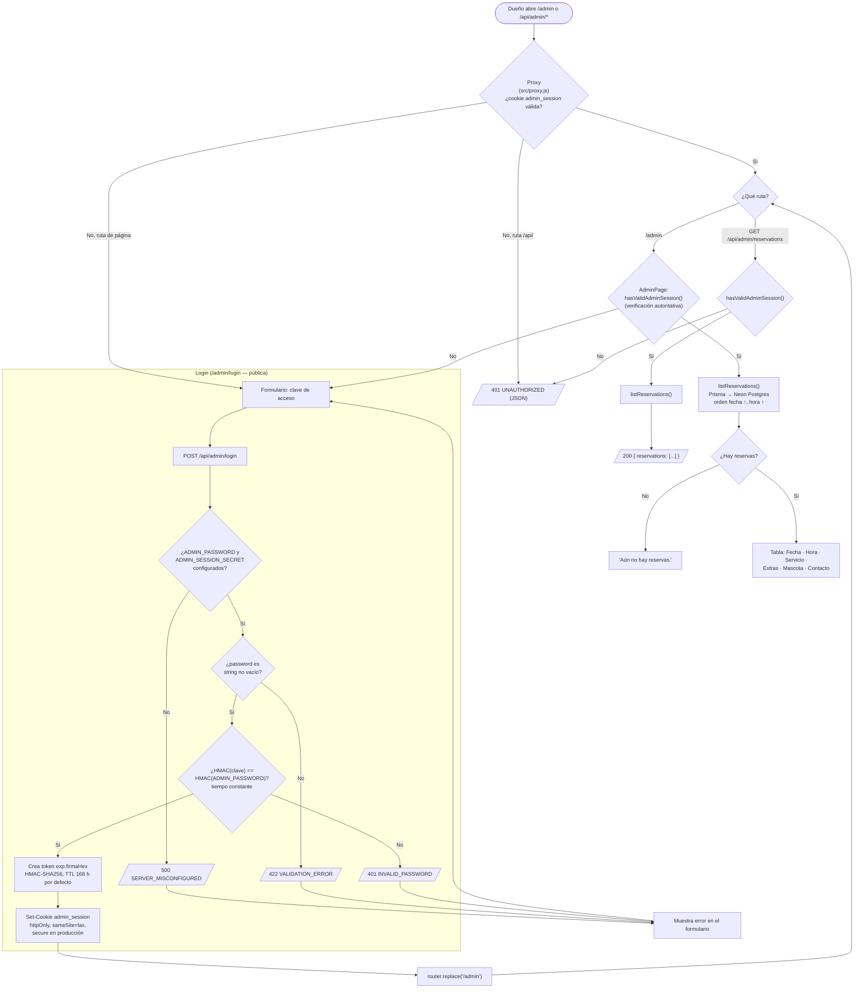

# Panel de administración — diagrama de flujo (v1.0.0)

## Historial

| Versión | Fecha | Cambio |
|---|---|---|
| 1.0.0 | 2026-10-05 | Versión inicial: login por clave única, cookie HMAC y listado de reservas |

## Notas

- **Doble barrera (ADR-0008):** el Proxy es una barrera optimista; cada página/handler vuelve a verificar la sesión.
- **Sin cuentas ni roles:** una sola clave compartida (`ADMIN_PASSWORD`); la sesión dura `ADMIN_SESSION_TTL_HOURS` (por defecto 168 h).
- **Pendiente respecto al PRD:** la vista actual solo lista reservas; el botón de reenvío por WhatsApp (`wa.me`) no aparece en `src/app/admin/page.jsx`.
