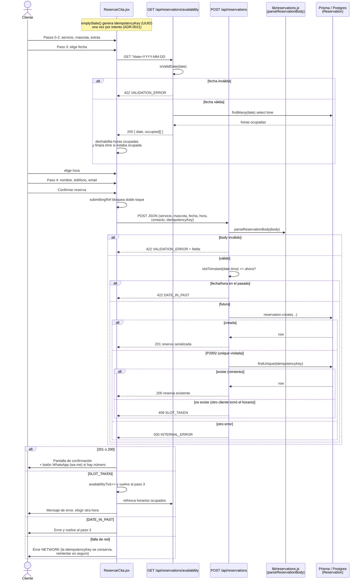

# Reserva de citas — diagrama de secuencia (v1.0.0)

## Historial

| Versión | Fecha      | Cambio                                   |
|---------|------------|------------------------------------------|
| 1.0.0   | 2026-10-05 | Versión inicial, generada desde el código |

## Diagrama

## Notas

- **Doble booking:** lo evita una constraint única en la base de datos. La disponibilidad en UI es solo ayuda visual; el servidor decide (`409 SLOT_TAKEN`).
- **Idempotencia:** ante `P2002`, si existe una reserva con la misma `idempotencyKey` es un reintento (`200`); si no, el horario fue tomado (`409`).
- **Fuera del diagrama:** `GET /api/admin/reservations` (requiere sesión admin).
