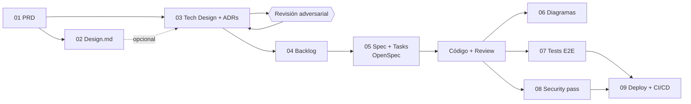

# Documentación — pipeline AI-First

Esta carpeta está ordenada en el mismo orden en que se construyó el proyecto. Cada paso
**consume el documento anterior**. Ninguno es un documento suelto: si el PRD cambia, el
diseño técnico, el backlog y las specs tienen que responder a ese cambio.

## Los pasos

| # | Carpeta | Sesión | Artefacto | Cómo se generó | Consume |
|---|---|---|---|---|---|
| 01 | [`01-producto/`](01-producto/) | S06 | [`PRD.md`](01-producto/PRD.md) | Skill `generar-prd-conversacional`, revisado y pulido a mano | La idea del producto |
| 02 | [`02-diseno/`](02-diseno/) | S06 | [`DESIGN.md`](02-diseno/DESIGN.md) *(opcional)* | Stitch + Claude Design, a partir del PRD | PRD |
| 03 | [`03-arquitectura/`](03-arquitectura/) | S07 | [`TECH-DESIGN.md`](03-arquitectura/TECH-DESIGN.md) + [`adrs/`](03-arquitectura/adrs/) | Skill `generar-tech-design` (entrevista decisión por decisión) + `revision-adversarial` con contexto fresco | PRD (+ DESIGN) |
| 04 | [`04-backlog/`](04-backlog/) | S08 | [`BACKLOG.md`](04-backlog/BACKLOG.md) | Skill `generar-backlog`, ordenado por dependencias | PRD + TECH-DESIGN + ADRs |
| 05 | [`05-specs/`](05-specs/) | S08–S09 | [`openspec/`](../openspec/) (en la raíz) | OpenSpec: `propose → apply → archive`, un change por ítem del backlog | Un ítem del BACKLOG |
| 06 | [`06-diagramas/`](06-diagramas/) | S10 | Secuencia de reserva y flujo de admin | Skill `mermaid-diagrams` / Archify sobre el código real (CodeGraph) | Código |
| 07 | [`07-testing/`](07-testing/) | S11 | [`tests/`](../tests/) (en la raíz) | Skill `playwright-e2e-test` | PRD (criterios de éxito y casos borde) |
| 08 | [`08-seguridad/`](08-seguridad/) | S12 | [`SECURITY-REPORT.md`](08-seguridad/SECURITY-REPORT.md) | Skill `security-pass` (solo análisis, con evidencia) | Código + TECH-DESIGN |
| 09 | [`09-deploy/`](09-deploy/) | S13 | [`DEPLOY-PLAN.md`](09-deploy/DEPLOY-PLAN.md) + [`ci-cd.yml`](../.github/workflows/ci-cd.yml) | Skill `deploy-pass` (diseña antes de ejecutar) | Código + tests + SECURITY-REPORT |

En la raíz quedan los dos archivos que leen las herramientas, no las personas:
[`CLAUDE.md`](../CLAUDE.md) (contexto y reglas para el agente) y [`README.md`](../README.md)
(portada del proyecto, S14).

## Trazabilidad: cómo se ve que un documento "responde" al anterior

Un ejemplo real de este repo, de punta a punta:

1. **PRD**, caso borde: *"Dos clientes intentan reservar el mismo slot casi al mismo tiempo →
   solo una reserva debe quedar confirmada"*.
2. **TECH-DESIGN**, [ADR-0007](03-arquitectura/adrs/0007-anti-doble-booking-unique-constraint.md):
   se resuelve con una constraint `UNIQUE (date, time)` en la base, no con un chequeo previo.
3. **Revisión adversarial**: encontró que un reintento devolvía `409` sobre la propia reserva del
   cliente → [ADR-0011](03-arquitectura/adrs/0011-idempotencia-creacion-reserva.md) (idempotencia).
   La versión anterior se conserva en [`TECH-DESIGN-v1.md`](03-arquitectura/TECH-DESIGN-v1.md).
4. **BACKLOG**, ítem #4: *"Endpoints de reserva: creación idempotente + disponibilidad"*, que cita
   ADR-0007 y ADR-0011.
5. **OpenSpec**: change
   [`2026-10-04-endpoints-reserva-idempotente-disponibilidad`](../openspec/changes/archive/2026-10-04-endpoints-reserva-idempotente-disponibilidad/)
   → spec vigente [`reservation-api`](../openspec/specs/reservation-api/spec.md).
6. **Test E2E**: `tests/reservar-cita-errores.spec.js` → *"si otro cliente toma el horario, se avisa
   y se vuelve a elegir"*.

## Sobre las skills y las rutas

Las skills del curso escriben por defecto en la raíz del repo (`PRD.md`, `TECH-DESIGN.md`,
`adrs/`…). En este proyecto se movieron a su carpeta numerada. Al usar una skill, indícale la
ruta de destino. `CLAUDE.md` ya lo instruye para el agente.
